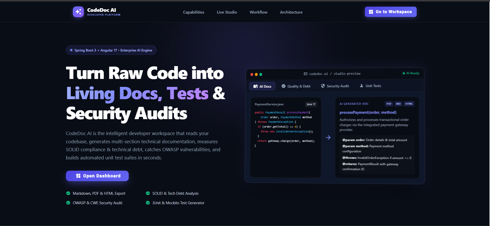
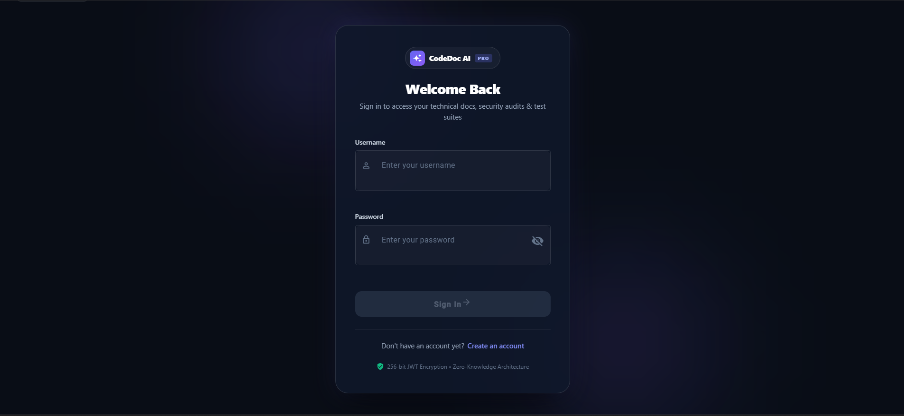
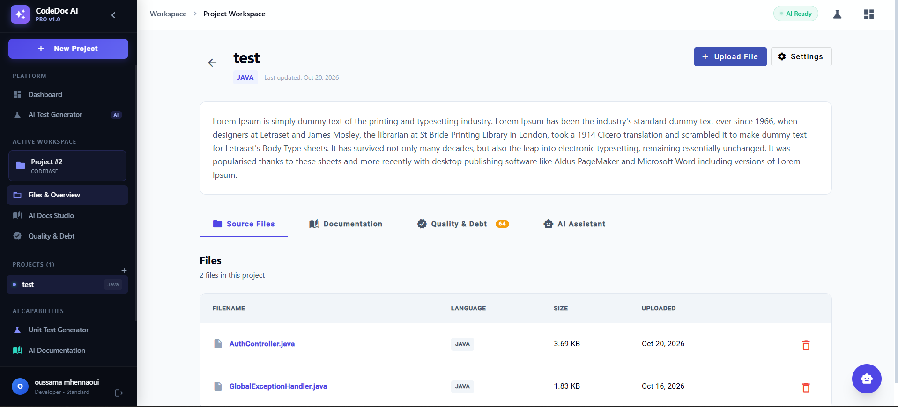
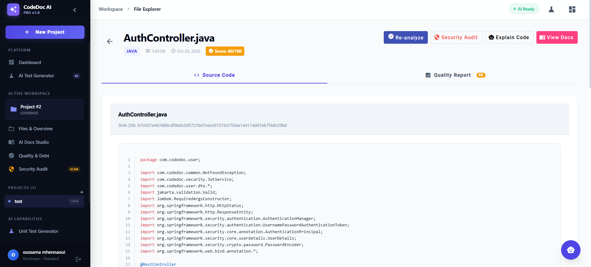
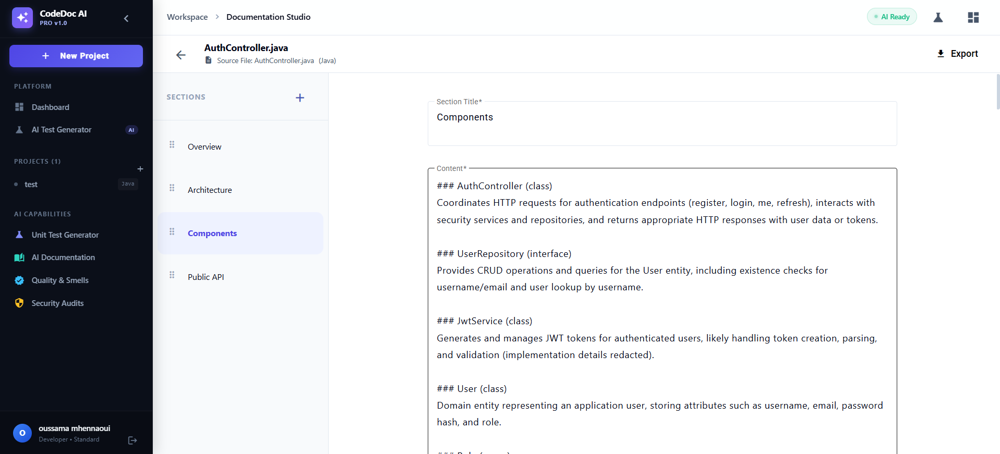
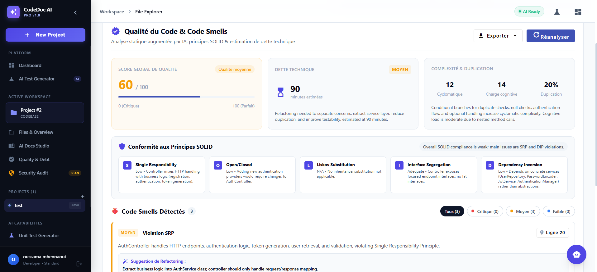
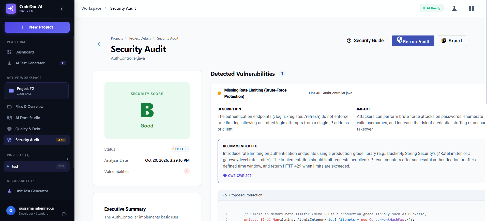
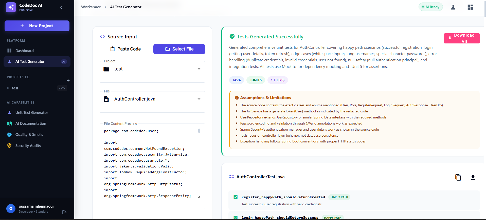
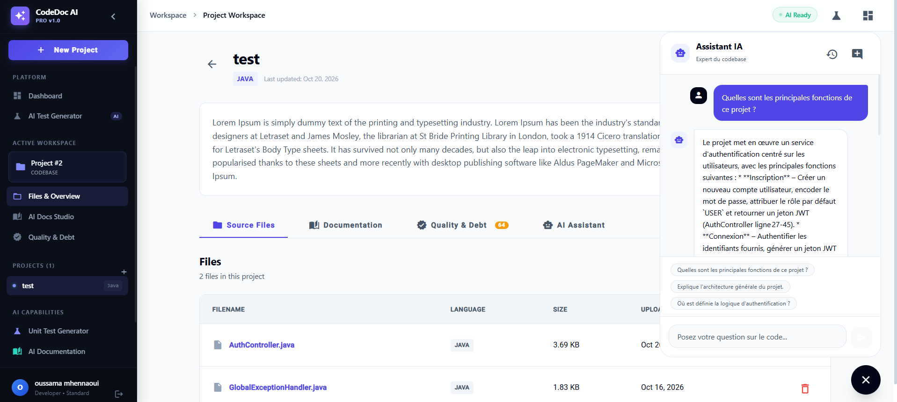

# CodeDoc AI ⚡

[](https://spring.io/projects/spring-boot)
[](https://www.oracle.com/java/)
[](https://angular.dev/)
[](https://www.postgresql.org/)
[](https://www.docker.com/)
[](LICENSE)

> **CodeDoc AI** is an enterprise-grade, AI-powered developer intelligence platform. It transforms raw source code into structured documentation, audits technical debt and SOLID compliance, identifies OWASP security vulnerabilities with remediation patches, generates comprehensive unit test suites, and provides a contextual RAG-powered codebase assistant.

---

## 📑 Table of Contents

- [Core Capabilities](#-core-capabilities)
- [Screenshots & Visual Guide](#-screenshots--visual-guide)
  - [Where to Place Photos & File Naming](#-where-to-place-photos--file-naming)
  - [Visual Walkthrough](#-visual-walkthrough)
- [Architecture & Design](#-architecture--design)
- [Tech Stack](#-tech-stack)
- [Database Schema](#-database-schema)
- [Complete REST API Reference](#-complete-rest-api-reference)
- [Getting Started](#-getting-started)
  - [Option 1: Docker Compose (Quickstart)](#option-1-docker-compose-quickstart)
  - [Option 2: Local Development Setup](#option-2-local-development-setup)
- [Configuration & Environment Variables](#-configuration--environment-variables)
- [Testing & Quality Assurance](#-testing--quality-assurance)
- [Contributing & License](#-contributing--license)

---

## 🌟 Core Capabilities

CodeDoc AI delivers 6 interconnected AI and developer-productivity pillars:

### 1. 📖 AI-Driven Technical Documentation Engine
- **Automated Breakdown**: Parses source files into structured, semantic sections (Overview, Architecture, Classes, Methods, Dependencies, Edge Cases).
- **Strict Schema Enforcement**: Responses are validated through **NetworkNT JSON Schema Validator** against `generate_doc_schema.json` before persistence.
- **Interactive Studio**:
  - Side-by-side synchronized view with source code syntax highlighting.
  - **CDK Drag-and-Drop Reordering**: Rearrange documentation sections intuitively with live position synchronization.
  - **Inline Section Editing**: Modify markdown text, update section titles, or add custom manual sections.
  - **Threaded Discussions**: Add line-specific comments and collaborate directly on generated sections.
- **Multi-Format Export**: One-click export to **Markdown (`.md`)**, formatted **PDF (`.pdf` via OpenPDF)**, or styled **HTML (`.html`)**.

### 2. 📊 Code Quality & Technical Debt Analyzer (Module 1)
- **0–100 Global Quality Score**: Instant visual health indicator (Good $\ge 80$, Medium $50-79$, Poor $< 50$).
- **SOLID Principles Compliance Matrix**: Line-by-line verification and compliance grading for Single Responsibility (SRP), Open-Closed (OCP), Liskov Substitution (LSP), Interface Segregation (ISP), and Dependency Inversion (DIP).
- **Code Smell Classification**: Detection categorized by severity (**Critical**, **Major**, **Minor**) with exact code line references.
- **Technical Debt Quantification**:
  - Calculates remediation effort in minutes and hours.
  - Assigns SQALE-standard Debt Ratings from **Grade A** (minimal debt) to **Grade E** (urgent remediation).
- **Executive PDF / Markdown Reports**: Downloadable audit documentation for stakeholders and pull request reviews.

### 3. 🛡️ Security & Vulnerability Audit (Module 2)
- **OWASP Top 10 Scans**: Automated security inspection for SQL Injections (CWE-89), Cross-Site Scripting (CWE-79), Hardcoded Credentials (CWE-798), Broken Access Control, Insecure Deserialization, and more.
- **CVSS v3.1 Severity Scoring**: Pinpoint vulnerabilities rated as Critical, High, Medium, or Low.
- **Unified Code Remediation Patches**: Generates immediate, side-by-side git diff remediation patches that developers can copy and apply.
- **Formal Security Export**: Generate official security audit reports in PDF format for compliance.

### 4. 🧪 Automated Unit Test Generator
- **Multi-Framework & Multi-Language**:
  - **Java**: JUnit 5 + Mockito
  - **TypeScript / JavaScript**: Jest
  - **Python**: pytest + unittest.mock
- **Full-Spectrum Coverage**: Generates happy path validations, boundary & edge condition tests, and exception handling tests.
- **Smart Mocking**: Automatically synthesizes mock dependencies, test fixtures, and assertions.
- **Export & Bundling**: Download individual test files or download the entire suite bundled as a `.zip` archive.

### 5. 💬 Contextual RAG Codebase Chatbot
- **Repository & File-Aware**: Injects active source code and project context into conversational prompts.
- **Instant Code Explanations**: One-click "Explain with AI" actions from file viewers.
- **Suggested Inquiries**: Built-in quick prompts for architecture queries, concurrency patterns, and optimization recommendations.
- **Persistent Histories**: Chat history and conversation threads stored securely per project and user.

### 6. 🔍 Complexity Detection & LLM Observability
- **Cognitive & Cyclomatic Analysis**: Identifies deeply nested logic, branch density, and high-maintenance functions.
- **Anonymization Engine**: Automatically redacts sensitive information (emails, secrets, personal data) before sending payloads to LLM providers.
- **AI Audit Trail (`ai_logs`)**: Records token consumption, execution latency, model versions, and status for cost governance and debugging.

---

## 📸 Screenshots & Visual Guide

### 📂 Where to Place Photos & File Naming

To display images in this README and repository documentation, create your screenshots and place them inside the **`docs/images/`** directory using the exact file names below:

> **Directory Path:** `docs/images/`

| File Name | Recommended View / Content |
| :--- | :--- |
| `01-landing-page.png` | Landing page hero banner, features grid, and the interactive preview studio |
| `02-auth-signin.png` | Glassmorphic Sign In / Register page with glowing ambient orbs |
| `03-dashboard.png` | Main Dashboard displaying project cards, stats, and quick actions |
| `04-file-view.png` | Source file inspector with syntax highlighting, tabs, and action toolbar |
| `05-doc-editor.png` | Documentation Studio showing dual-column editor, drag-and-drop sections, and comments |
| `06-quality-audit.png` | Code Quality & Technical Debt dashboard with SOLID scores and smell breakdowns |
| `07-security-audit.png` | Security Audit page displaying OWASP findings, CVSS scores, and remediation diffs |
| `08-unit-test-generator.png`| Unit Test Generator interface with framework selectors and generated test suites |
| `09-rag-chatbot.png` | Interactive floating RAG Chatbot answering questions with contextual code references |

---

### 🖼️ Visual Walkthrough

#### 1. Modern Landing Page & Interactive Preview Studio
*Welcome page highlighting CodeDoc AI's 6 pillars and live feature demonstrations.*


#### 2. Glassmorphic Authentication
*Sleek, dark-mode sign-in and registration with JWT session restoration.*


#### 3. Project Management Dashboard
*Project workspace directory showing file counts, languages, and quick action shortcuts.*


#### 4. Source File Inspector & Syntax Viewer
*High-performance source code viewer with SHA-256 checksums and quick-launch AI triggers.*


#### 5. Interactive Documentation Studio
*Two-column layout with CDK drag-and-drop section reordering, inline edits, and threaded review comments.*


#### 6. Code Quality, SOLID & Technical Debt Dashboard
*Health score gauge (0-100), SOLID principles compliance, code smells, and SQALE debt estimation.*


#### 7. Security & Vulnerability Audit
*OWASP Top 10 vulnerability scanner with CVSS severity badges and unified patch diffs.*


#### 8. Automated Unit Test Generator
*Production-ready unit test synthesis for Java (JUnit 5 / Mockito), TypeScript (Jest), and Python (pytest).*


#### 9. Contextual RAG Codebase Assistant
*Floating AI assistant with project scoping, pre-configured prompts, and code explanations.*


---

## 🏗️ Architecture & Design

CodeDoc AI is structured into decoupled layers separating fast CRUD data access from the AI intelligence pipeline:

```text
┌────────────────────────────────────────────────────────────────────────┐
│                        Angular 17 Client (SPA)                         │
│   Standalone Components • Signals • Angular Material • CDK Drag/Drop   │
└───────────────────────────────────┬────────────────────────────────────┘
                                    │ HTTP / REST (JWT Bearer)
                                    ▼
┌────────────────────────────────────────────────────────────────────────┐
│                        Spring Boot 3.2 Backend                         │
│  ┌───────────────────────────────┐  ┌────────────────────────────────┐ │
│  │       Core CRUD Services      │  │      AI Intelligence Layer     │ │
│  │  Auth • Projects • SourceFiles│  │ Anonymizer • Prompt Engine     │ │
│  │  Docs • Sections • Comments   │  │ Schema Validator (NetworkNT)   │ │
│  │  Quality • Security • Tests   │  │ Export Engine (OpenPDF)        │ │
│  └──────────────┬────────────────┘  └───────────────┬────────────────┘ │
└─────────────────┼───────────────────────────────────┼──────────────────┘
                  │ JDBC / JPA                        │ HTTP (OpenAI / OpenRouter)
                  ▼                                   ▼
┌──────────────────────────────────┐  ┌──────────────────────────────────┐
│      PostgreSQL 15 Database      │  │     External LLM Provider API    │
│  Users, Projects, Files, Docs,   │  │   GPT-4o, Claude 3.5, or Local   │
│  Quality Reports, Logs, Chats    │  │   OpenAI-compatible endpoints    │
└──────────────────────────────────┘  └──────────────────────────────────┘
```

### Safety & Reliability Guarantees
1. **PII & Data Redaction**: The backend anonymizer sanitizes emails, IP addresses, credentials, and phone numbers before prompt composition.
2. **Strict Schema Validation**: LLM responses are parsed and validated against strict JSON schemas. Malformed outputs are rejected before database insertion.
3. **Auditability**: Every prompt execution, latency measurement, and token counter is logged into `ai_logs` for transparency.
4. **Isolated Tenant Access**: Spring Security filters and JPA queries enforce strict user ownership boundaries across all endpoints.

---

## 💻 Tech Stack

### Backend
- **Framework:** Spring Boot 3.2.x (Java 17)
- **Security:** Spring Security 6 with JJWT 0.12.5 (Stateless JWT authentication & BCrypt)
- **Database & Persistence:** PostgreSQL 15, Spring Data JPA, Hibernate, Flyway Migrations
- **JSON Validation:** NetworkNT JSON Schema Validator 1.3.3
- **PDF Generation:** OpenPDF 1.3.39
- **Build Tool:** Maven 3.9+ with wrapper (`./mvnw`)

### Frontend
- **Framework:** Angular 17.x (Standalone Architecture)
- **State & Reactivity:** Angular Signals & RxJS
- **UI Components:** Angular Material 17
- **Drag-and-Drop:** Angular CDK (`@angular/cdk/drag-drop`)
- **Syntax Highlighting:** `ngx-highlightjs` with Highlight.js
- **Styling:** Custom Vanilla SCSS with Dark Glassmorphism, CSS Custom Properties, and responsive flex/grid layouts

### DevOps & Containerization
- **Containerization:** Docker & Multi-stage `Dockerfile` (Spring Boot layered JAR + Nginx Angular build)
- **Orchestration:** Docker Compose

---

## 🗄️ Database Schema

The database schema is managed via Flyway migrations and strictly enforces foreign keys, cascades, and data integrity:

| Table | Purpose & Details |
| :--- | :--- |
| **`users`** | User authentication records (`id`, `username`, `email`, `password` hash, `role`, `created_at`). |
| **`projects`** | Project containers owned by a user (`id`, `name`, `description`, `user_id`, `created_at`). |
| **`source_files`** | Uploaded code files (`id`, `filename`, `content`, `language`, `size_bytes`, `checksum`, `project_id`). |
| **`generated_docs`** | Root document entity linked 1-to-1 with a source file (`id`, `title`, `file_id`, `created_at`). |
| **`doc_sections`** | Structured documentation sections (`id`, `title`, `content`, `section_type`, `position`, `doc_id`). |
| **`comments`** | Threaded feedback discussions on individual doc sections (`id`, `content`, `user_id`, `section_id`). |
| **`quality_reports`**| Comprehensive quality analysis (`id`, `file_id`, `score_global`, `smells_json`, `solid_json`, `debt_minutes`, `debt_rating`). |
| **`ai_logs`** | Observability audit trail (`id`, `user_id`, `operation_type`, `model`, `tokens_used`, `latency_ms`, `status`). |
| **`conversations`** | RAG chat conversation sessions per project (`id`, `title`, `user_id`, `project_id`, `created_at`). |
| **`chat_messages`** | Individual chat exchanges (`id`, `conversation_id`, `sender`, `message_text`, `timestamp`). |

---

## 🔌 Complete REST API Reference

All protected endpoints require the HTTP header:  
`Authorization: Bearer <JWT_TOKEN>`

### 🔑 Authentication (`/api/auth`)
| Method | Endpoint | Description |
| :--- | :--- | :--- |
| `POST` | `/api/auth/register` | Register a new user account |
| `POST` | `/api/auth/login` | Authenticate and obtain JWT token |
| `GET` | `/api/auth/me` | Fetch authenticated user profile |

### 📁 Projects (`/api/projects`)
| Method | Endpoint | Description |
| :--- | :--- | :--- |
| `GET` | `/api/projects` | List all projects belonging to the user |
| `POST` | `/api/projects` | Create a new project |
| `GET` | `/api/projects/{id}` | Retrieve project details and associated files |
| `PATCH` | `/api/projects/{id}` | Update project metadata |
| `DELETE` | `/api/projects/{id}` | Delete project and cascade-delete all assets |

### 📄 Source Files (`/api/projects/{id}/files` & `/api/files`)
| Method | Endpoint | Description |
| :--- | :--- | :--- |
| `POST` | `/api/projects/{id}/files` | Upload source file(s) to a project |
| `GET` | `/api/files/{id}` | Retrieve raw file contents, language, and checksum |
| `DELETE` | `/api/files/{id}` | Delete a source file |

### 🤖 AI Operations (`/api/ai`)
| Method | Endpoint | Description |
| :--- | :--- | :--- |
| `POST` | `/api/ai/generate-doc` | Generate structured documentation for a file |
| `POST` | `/api/ai/detect-complexity` | Run cognitive and branch complexity analysis |

### 📝 Documentation Studio (`/api/docs` & `/api/sections`)
| Method | Endpoint | Description |
| :--- | :--- | :--- |
| `GET` | `/api/docs/{id}` | Fetch generated document with sections |
| `PATCH` | `/api/docs/{id}` | Update document title or status |
| `DELETE` | `/api/docs/{id}` | Delete documentation |
| `GET` | `/api/docs/{id}/export?format={md\|pdf\|html}` | Export documentation to Markdown, PDF, or HTML |
| `GET` | `/api/docs/{id}/sections` | List all sections for a document |
| `POST` | `/api/docs/{id}/sections` | Add a manual section |
| `PATCH` | `/api/sections/{id}` | Update section title, text, or type |
| `DELETE` | `/api/sections/{id}` | Delete a specific section |
| `POST` | `/api/docs/{id}/sections/reorder` | Bulk update section positions (Drag-and-Drop) |
| `GET` | `/api/sections/{id}/comments` | List comments for a section |
| `POST` | `/api/sections/{id}/comments` | Post a comment on a section |

### 📊 Code Quality & Technical Debt (`/api/quality`)
| Method | Endpoint | Description |
| :--- | :--- | :--- |
| `POST` | `/api/quality/analyze` | Trigger SOLID, code smells, and debt analysis |
| `GET` | `/api/quality/files/{fileId}` | Get quality analysis report for a file |
| `GET` | `/api/quality/projects/{projectId}/summary`| Get project-level aggregated quality summary |
| `GET` | `/api/quality/reports/{id}/export?format={pdf\|md}`| Export quality report to PDF or Markdown |

### 🛡️ Security Audit (`/api/audit`)
| Method | Endpoint | Description |
| :--- | :--- | :--- |
| `POST` | `/api/audit` | Execute security vulnerability audit on a file |
| `GET` | `/api/audit/project/{projectId}` | Retrieve all security audits for a project |
| `GET` | `/api/audit/file/{fileId}` | Retrieve security audit history for a file |
| `GET` | `/api/audit/{auditId}` | Get audit details with CWE findings and diff patches |
| `GET` | `/api/audit/{auditId}/export/pdf` | Export security audit report as a PDF |

### 🧪 Automated Unit Test Generator (`/api/test-generations`)
| Method | Endpoint | Description |
| :--- | :--- | :--- |
| `POST` | `/api/test-generations` | Generate unit test suites (JUnit 5, Jest, pytest) |
| `GET` | `/api/test-generations/{id}` | Fetch test generation details and test code |
| `GET` | `/api/test-generations/history` | List test generation history for current user |
| `GET` | `/api/test-generations/by-project/{projectId}` | List test generations for a specific project |
| `GET` | `/api/test-generations/{id}/download` | Download generated test suite as `.zip` or file |

### 💬 Contextual RAG Chatbot (`/api/chat`)
| Method | Endpoint | Description |
| :--- | :--- | :--- |
| `POST` | `/api/chat` | Send a prompt to the RAG assistant (scoped to project/file) |
| `GET` | `/api/chat/conversations?projectId={id}` | List user conversation threads for a project |
| `GET` | `/api/chat/conversations/{id}/messages` | Retrieve conversation message history |
| `DELETE`| `/api/chat/conversations/{id}` | Delete a conversation thread |
| `GET` | `/api/chat/suggested-questions` | Get pre-configured quick suggestion prompts |

---

## 🚀 Getting Started

### Option 1: Docker Compose (Quickstart)

The easiest way to launch the complete system (PostgreSQL + Spring Boot API + Angular UI):

1. **Clone the repository:**
   ```bash
   git clone https://github.com/oussama-mhennaoui/codedoc-ai.git
   cd codedoc-ai
   ```

2. **Configure your environment variables in `.env`:**
   ```env
   OPENAI_API_KEY=your_openai_or_openrouter_api_key_here
   AI_API_URL=https://openrouter.ai/api/v1
   JWT_SECRET=your_super_secret_256_bit_jwt_key_must_be_long_and_secure
   ```

3. **Start all services:**
   ```bash
   docker compose up --build
   ```

4. **Access the application:**
   - **Frontend UI:** `http://localhost:4200`
   - **Backend REST API:** `http://localhost:8081`
   - **PostgreSQL Database:** `localhost:5432`

---

### Option 2: Local Development Setup

#### Prerequisites
- **Java 17 SDK** (e.g. Eclipse Temurin / OpenJDK 17)
- **Node.js 18+** and **npm 9+**
- **PostgreSQL 15** running locally

#### 1. Setup Database
```sql
CREATE DATABASE codedoc;
CREATE USER codedoc WITH PASSWORD 'codedoc';
GRANT ALL PRIVILEGES ON DATABASE codedoc TO codedoc;
```

#### 2. Start Backend
```bash
cd backend
./mvnw clean spring-boot:run
```
*(On Windows Command Prompt or PowerShell, use `mvnw.cmd spring-boot:run`)*  
The backend will automatically apply Flyway migrations and listen on `http://localhost:8081`.

#### 3. Start Frontend
```bash
cd frontend
npm install
npm run start
```
The Angular application will launch and be accessible at `http://localhost:4200`.

---

## ⚙️ Configuration & Environment Variables

The backend is configured via `application.yml` and can be overridden using environment variables:

| Variable | Description | Default / Example |
| :--- | :--- | :--- |
| `SPRING_DATASOURCE_URL` | PostgreSQL JDBC connection URL | `jdbc:postgresql://localhost:5432/codedoc` |
| `SPRING_DATASOURCE_USERNAME` | Database username | `codedoc` |
| `SPRING_DATASOURCE_PASSWORD` | Database password | `codedoc` |
| `JWT_SECRET` | 256-bit secret string for signing JWT tokens | *(Required - Keep confidential)* |
| `JWT_EXPIRATION_MS` | JWT validity duration in milliseconds | `86400000` (24 Hours) |
| `OPENAI_API_KEY` | API Key for LLM services (OpenAI / OpenRouter) | *(Required for AI features)* |
| `AI_API_URL` | Base endpoint for LLM API | `https://openrouter.ai/api/v1` |
| `AI_MODEL` | Default LLM model identifier | `openai/gpt-4o-mini` |

---

## 🧪 Testing & Quality Assurance

### Run Backend Unit & Integration Tests
```bash
cd backend
./mvnw test
```

### Build Frontend for Production
```bash
cd frontend
npm run build
```

---

## 🤝 Contributing & License

Contributions, bug reports, and feature suggestions are welcome!

1. Fork the Project
2. Create your Feature Branch (`git checkout -b feature/AmazingFeature`)
3. Commit your Changes (`git commit -m 'Add some AmazingFeature'`)
4. Push to the Branch (`git push origin feature/AmazingFeature`)
5. Open a Pull Request

Distributed under the **MIT License**. See `LICENSE` for more information.
